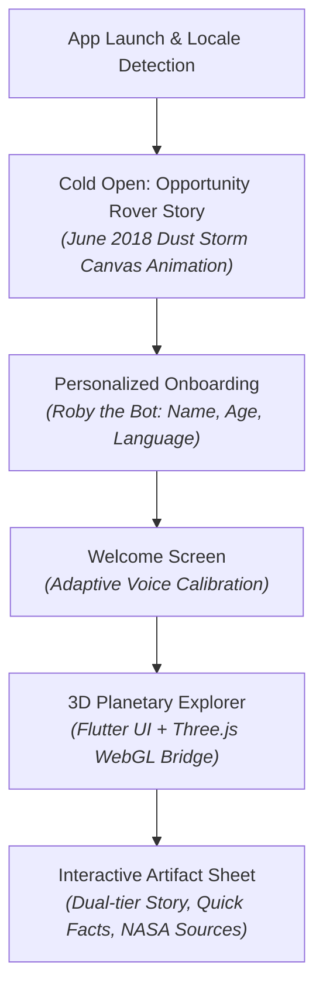

# NASA Space Apps Challenge: Ghosts of the Sky (Project Report)

**Challenge Category:** *Tell the Story of Abandoned NASA Hardware Across the Solar System*  
**Target Audience:** School-age space enthusiasts (Ages 4–9 and 10+)  
**Current Tech Stack:** Flutter (cross-platform UI & state engine), Three.js r170 (WebGL 3D planetary rendering), InAppWebView bridge, localized JSON knowledge base  

---

## 1. Executive Summary & Project Aim

### 1.1 The Challenge
Since the early 1960s, humanity's exploration of the cosmos has left hardware scattered across our solar system—resting on lunar plains, dormant in Martian dust basins, and coasting toward interstellar space. While many missions have officially concluded, each piece of equipment represents an enduring milestone of human curiosity, engineering bravery, and fundamental scientific discovery.

The NASA Space Apps Challenge calls for an engaging, accessible educational platform that introduces school-age children to these historic relics, the science they made possible, and why they remain where they are.

### 1.2 Core Project Vision: From Cold Hardware to "Living Space Ghosts"
Our project, **Ghosts of the Sky** (*মহাকাশের ভুলে যাওয়া বন্ধুরা*), reimagines abandoned space hardware as friendly, heroic characters waiting to tell their stories. Rather than presenting a dry database, the app blends:
- **Narrative Storytelling:** Emotional first-person storytelling calibrated for child comprehension.
- **Adaptive Age-Tiering:** Distinct narratives for younger explorers (ages 4–9, focus on sensory awe and relatable personification) and older youth (10+, focus on mission engineering, scientific payloads, and historical context).
- **Interactive 3D Solar Archaeology:** A physical, tangible sense of location through 3D planetary globes showing real landing coordinates verified against NASA/JPL databases.
- **Bilingual Inclusivity:** Native English and Bengali (বাংলা) support from day one, expanding global access to space education.

---

## 2. What Is Currently Implemented

The current codebase is a fully functioning proof-of-concept (POC) built on a Flutter + Three.js architecture.



### 2.1 Personalized Onboarding & Cold Open
- **Cold Open Experience (`StoryIntroScreen`):** An animated prologue set on Mars in June 2018. A custom Flutter canvas painter simulates the planet darkening during a global dust storm as solar power diminishes, highlighting Opportunity's final poignant transmission (*"My battery is low and it's getting dark"*) and celebrating its 15-year legacy against a 90-day design specification.
- **Roby Onboarding (`OnboardingScreen`):** An interactive companion robot ("Roby") collects the user's preferred language, name, and age.
- **Age-Tier Engine (`AppState`):** Classifies users into:
  - `Tier.young` (Ages 4–9): Emphasizes curiosity, visual analogies, and character-driven dialogue.
  - `Tier.older` (Ages 10+): Emphasizes scientific instruments, telemetry, and planetary geography.
- **Bilingual Support (`strings.dart`):** Complete UI and narrative strings in English and Bengali with native font rendering (`BalooDa2`) and localized Bengali numerals (`০-৯`).

### 2.2 3D Planetary Explorer & Bi-Directional Bridge
- **Three.js WebGL Engine (`assets/web/index.html`):** Renders interactive 3D celestial bodies (Moon and Mars) with ambient and directional solar lighting, starfields, touch rotation, inertia, and pinch-to-zoom.
- **Procedural & Texture-Mapped Bodies:** High-resolution lunar surface mapping with procedural texture fallbacks for Mars.
- **Coordinate Projection:** Math engine converting NASA latitude/longitude coordinates into 3D Cartesian spherical coordinates on the planetary sphere.
- **JavaScript ↔ Flutter Bridge (`bridge_spec.md`):**
  - **Flutter → WebGL:** `setBody(body, sites)`, `focusOn(id)`, `resetView()`.
  - **WebGL → Flutter:** `onSceneReady`, `onBodyReady`, `onMarkerTapped(id)`, `onCameraArrived(id)`.

### 2.3 Curated Artifact Knowledge Base (`assets/data/artifacts.json`)
Currently holds 10 verified historical spacecraft with dual age-tier stories and NASA NSSDCA / LRO citation links:
- **The Moon:** Apollo 11 (*Eagle* descent stage & Lunar Laser Retroreflector), Apollo 12 (adjacent to Surveyor 3), Apollo 14 (Fra Mauro highlands & Alan Shepard golf test), Apollo 15 (Lunar Roving Vehicle), Apollo 16, Apollo 17.
- **Mars:** Opportunity (*Oppy*), Spirit, Mars Pathfinder & Sojourner, Viking 1.

---

## 3. The New Pivot: "The Time Machine" Concept

### 3.1 Why Transition to a Time Machine?
While the Opportunity opening is emotionally resonant, starting in 2018 misses the grand chronological sweep of space history. The team’s new vision anchors the entire experience inside a **Temporal Discovery Vessel** (Time Machine).

Instead of dropping the user into an arbitrary era, Roby invites the user to board a Time Machine that dials back to the **1960s**—the dawn of planetary exploration. As users discover artifacts, they travel chronologically forward through time, understanding how each mission laid the scientific foundation for the next.

```mermaid
journey
    title The Chrononaut Journey
    section 1. Launchpad
      Roby Welcomes Chrononaut: 5: User
      Calibrate Time Machine (Name/Age/Lang): 5: User
    section 2. The 1960s: Lunar Pioneers
      Time Warp to 1960s: 5: User
      Surveyor & Lunar Orbiter: 4: App
      Apollo 11 Eagle Landing: 5: App
    section 3. The 1970s: Cold Plains & Red Horizons
      Time Leap to 1976: 4: App
      Viking 1 Touches Mars: 5: App
      Voyagers Depart Solar System: 5: App
    section 4. The 1990s-2000s: The Robotic Renaissance
      Mars Pathfinder & Sojourner (1997): 4: App
      Spirit & Opportunity Twins (2004): 5: App
    section 5. Present Day & Deep Space
      Status of Ghosts Today: 5: App
      Interstellar Drift: 5: App
```

### 3.2 Key Narrative & Experiential Anchors
1. **The 1960s Cold Open (The First Abandoned Relics):**
   - The user arrives in lunar orbit circa 1966–1967.
   - The first encounters: **Surveyor 1 & Surveyor 3** (automated lunar landers that proved the Moon's dust could support a spacecraft) and **Lunar Orbiter** crash sites.
   - The pinnacle moment: July 1969 — Neil Armstrong and Buzz Aldrin leave the descent stage of *Eagle* behind on Tranquility Base, along with the retroreflectors still used today.
2. **Temporal Leap to the 1970s:**
   - **Viking 1 & 2 (1976):** Landing on Mars' Chryse Planitia, sending the first clear surface pictures and chemical analyses of Martian soil.
   - **Voyager 1 & 2 / Pioneer 10 & 11:** The grand tour probes that finished planetary flybys and began their eternal drift out of the solar system.
3. **The 1990s & 2000s Rover Revolution:**
   - **Mars Pathfinder & Sojourner (1997):** The microwave-sized rover that proved mobile exploration was possible.
   - **Spirit & Opportunity (2004):** The twin geologists who confirmed Mars was once wet and habitable.

---

## 4. What We Want to Implement Next (Roadmap)

### Phase 1: Time Machine Shell & Chronological Navigation
- [ ] **Temporal Warp UI / Transition Screen:** Build a dynamic time-travel interface (chronometer dialing backwards from current year down to 1964/1966) using Flutter animations, audio cues, and warp shader effects.
- [ ] **Era-Based Interactive Timeline:** Introduce an interactive timeline scrubber allowing users to travel between eras:
  - *The Sixties: Reaching for the Moon* (1964–1969)
  - *The Seventies: First Footsteps on Mars & Beyond* (1970–1979)
  - *The Nineties: Small Steps, Giant Robots* (1990–1999)
  - *The New Millennium: Marathon Rovers* (2000–2019)
- [ ] **Locked/Unlocked Era Progression:** Gamify the flow—exploring artifacts in an earlier era powers up the Time Machine’s "Chrono-Core" to warp forward to subsequent decades.

### Phase 2: Content Expansion & 1960s Focus
- [ ] **Surveyor 1 & Surveyor 3 Integration:** Add Surveyor missions to `artifacts.json` to highlight pre-Apollo hardware (especially Surveyor 3, which Apollo 12 astronauts visited in 1969).
- [ ] **Deep Space & Trajectory Wanderers:**
  - Expand beyond Moon and Mars: Introduce an interplanetary solar system orbit view in Three.js.
  - Add **Voyager 1, Voyager 2, and Pioneer 10/11**, showing their hyperbolic trajectories leaving the heliosphere.
- [ ] **Micro-Story Cards:** Refine the artifact sheets for younger children into 2–3 swipeable illustrated story cards rather than single text blocks.

### Phase 3: Audiovisual & Interactive Polish
- [ ] **NASA Audio & Telemetry Reenactments:** Embed authentic audio clips (e.g. Apollo transmissions, digitized telemetry tones, Viking atmospheric readings).
- [ ] **High-Resolution Mars Textures & 3D Models:** Replace procedural fallback canvas textures with high-definition NASA elevation/color maps and replace simple marker spheres with lightweight 3D glTF models of landers/rovers.
- [ ] **Interactive Mini-Quizzes ("Time Cadet Challenges"):** Simple questions at each artifact (e.g., *"Why did Apollo 11 leave a mirror behind?"*) awarding time-travel badges to the user's Space Logbook.
- [ ] **Bengali Localization Review:** Native-speaker review of historical Bengali terminology to ensure natural phrasing and tone for Bangladeshi & West Bengali youth.

---

## 5. Summary Table: Current State vs. Next Iteration

| Feature Area | Current Implementation | Time Machine Themed Next Step |
|---|---|---|
| **Entry Experience** | Cold open story on 2018 Opportunity rover | Roby introduces the Time Machine; user warps back to 1960s |
| **Exploration Mode** | Unrestricted Moon / Mars toggle with markers | Chronological timeline eras (1960s $\to$ 1970s $\to$ 1990s $\to$ 2000s) |
| **Pioneering Relic** | Focus on Apollo 11 (Moon) & Opportunity (Mars) | Features Surveyor probes (pre-Apollo) and Apollo 11 descent stage |
| **Celestial Coverage** | Moon and Mars 3D spheres | Moon, Mars, plus Deep Space Trajectories (Voyager / Pioneer) |
| **Pedagogy** | Dual-tier first-person stories & facts | Narrative time-leaps showing how each era built upon the last |
| **Engagement** | Marker tapping & bottom sheet reading | Time Cadet logbook, badges, soundscapes, and swipeable cards |

---
*Report prepared for the NASA Space Apps Challenge team hackathon submission.*
